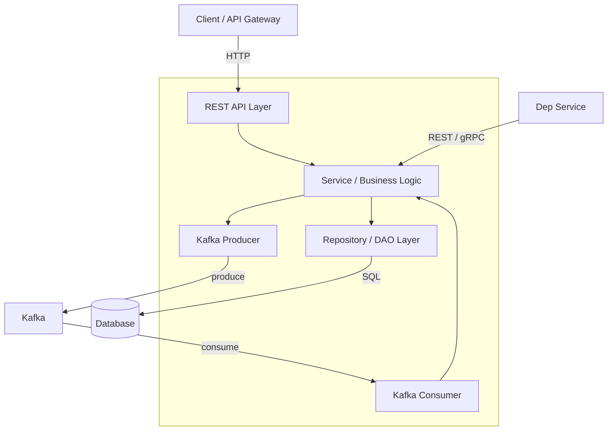

# Service Architecture Overview

---

## What This Service Does

<!-- 2–3 sentences describing the service's purpose, its consumers, and its place in the platform -->

---

## Component Diagram

<!-- TODO: customise with actual component names from code scan -->

---

## Technology Stack

| Layer | Technology | Version |
|---|---|---|
| Language | <!-- Java / Go / Python / Node --> | <!-- 17 / 1.21 / 3.11 --> |
| Framework | <!-- Spring Boot / Gin / FastAPI / Express --> | <!-- x.x --> |
| Database | <!-- PostgreSQL / MySQL / MongoDB --> | <!-- x.x --> |
| Message Broker | <!-- Kafka / RabbitMQ --> | <!-- x.x --> |
| Container | Docker + Kubernetes | — |

---

## Deployment

- **Kubernetes namespace**: <!-- service-namespace -->
- **Replicas**: <!-- min 2, max 10 (HPA) -->
- **Health check**: `GET /actuator/health` or equivalent
- **Readiness probe**: <!-- same or different endpoint -->

---

## Observability

| Signal | Tool | Dashboards / Alerts |
|---|---|---|
| Metrics | <!-- Prometheus + Grafana --> | <!-- link --> |
| Logs | <!-- ELK / CloudWatch --> | <!-- link --> |
| Traces | <!-- Jaeger / Zipkin / OTEL --> | <!-- link --> |
| Alerts | <!-- PagerDuty / OpsGenie --> | <!-- link --> |
