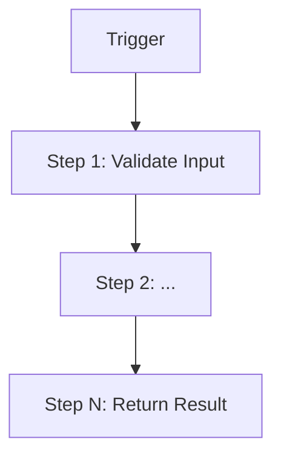

# Workflow: <!-- WORKFLOW_NAME -->

> **Purpose**: One paragraph describing what this workflow achieves from a product perspective.
> Who triggers it, what problem it solves, and what the successful outcome looks like.

---

## Trigger / Entry Points

> See `entry-points.md` for the full list.

- **Primary trigger**: <!-- e.g., API call / Kafka event / CLI command / cron job -->

---

## High-Level Flow

<!-- Replace with actual steps discovered from code scan -->

---

## Step-by-Step Breakdown

| # | Action | Component / Class | Notes |
|---|---|---|---|
| 1 | Validate input | <!-- ClassName --> | <!-- e.g., throws ValidationException --> |
| 2 | <!-- action --> | <!-- component --> | <!-- notes --> |

<!-- TODO: verify steps against source code -->

---

## Error Handling & Retry Logic

| Step | Failure Behaviour | Retry | Fallback |
|---|---|---|---|
| <!-- step # --> | <!-- what happens --> | <!-- Y/N, how many times --> | <!-- DLQ / alert / rollback --> |

<!-- TODO: fill from try/catch blocks and @Retryable annotations in code -->

---

## Affected DB Tables

| Table | Access | Notes |
|---|---|---|
| <!-- table_name --> | read / write / read-write | <!-- context --> |

→ See `helpers/db-tables/` for schema details.

---

## Affected Kafka Topics

| Topic | Produced / Consumed | Notes |
|---|---|---|
| <!-- topic.name --> | produced / consumed | <!-- context --> |

→ See `helpers/kafka/topics.md` for schema details.

---

## Cross-Repo Dependencies Used

| Dep Service | What We Call | KB Reference |
|---|---|---|
| <!-- service-name --> | <!-- e.g., POST /charge --> | `deps/<service-name>/apis/` |

---

## Related Workflows

- Triggered after: <!-- workflow name or 'none' -->
- Triggers before: <!-- workflow name or 'none' -->
- Can run in parallel with: <!-- workflow name or 'none' -->
